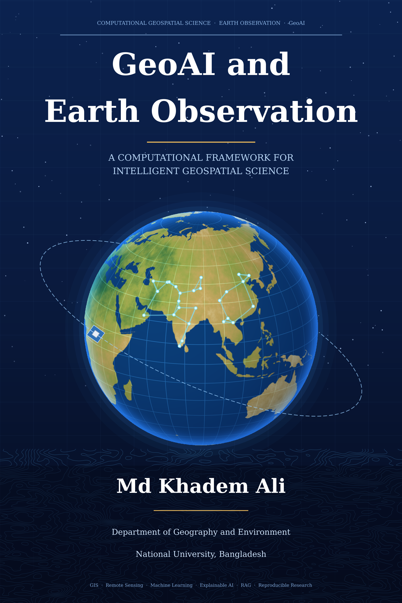

<div align="center">



## GeoAI and Earth Observation: A Computational Framework for Intelligent Geospatial Science

**Md Khadem Ali**
Department of Geography and Environment, National University, Bangladesh

[](https://colab.research.google.com/github/mdkhademali/GeoAI-Research-Book/blob/main/GeoAI_Research_Book.ipynb)


-0b3c78)

[Author website](https://khademali.com) · [GitHub profile](https://github.com/mdkhademali)

</div>

---

## Overview

*GeoAI and Earth Observation* is an interactive research book contained in a **single Jupyter Notebook**, [`GeoAI_Research_Book.ipynb`](GeoAI_Research_Book.ipynb). It develops a coherent computational framework that connects Geographic Information Systems (GIS), Earth observation, spatial data science, machine and deep learning, explainable AI, retrieval-augmented generation (RAG), language-model agents, and reproducible research practice.

Fifteen chapters in four parts combine scholarly exposition and mathematical formulation with executable Python. Each chapter follows one structure: introduction and objectives, conceptual foundations, theory, equations, methodological framework, implementation, figures and tables, interpretation, applications, limitations, key takeaways, summary and references (APA 7th edition).

## Abstract

Geospatial science is undergoing a methodological transition. Classical GIS and remote-sensing workflows, built on explicit spatial models, are being joined by data-driven learning systems that extract structure directly from large Earth-observation archives. This book presents a framework, *GeoAI*, that connects these traditions. It develops the foundations of spatial data science and Earth observation, feature engineering, supervised and deep learning, spatiotemporal modelling, explainable and uncertainty-aware prediction, retrieval-augmented generation, tool-using language-model agents, applied environmental analytics, spatial optimisation, digital twins, and reproducible practice. Every quantitative demonstration uses **synthetic data with known ground truth**, which allows claims about validation, explanation and uncertainty to be *tested* rather than asserted.

> **Important: all results in the notebook are computed on synthetic data.** No accuracy, trend, flood extent, population or other number describes any real place. Real open datasets (Sentinel-1/2, Landsat, MODIS, SRTM, OpenStreetMap, WorldPop and others) are documented in Appendix A and in each chapter's access examples, which are shown but **not executed**. No language model or external service is called anywhere in the notebook.

## Who should read this book

Graduate students, early-career researchers and practitioners in geography, environmental science, geomatics, remote sensing, planning, hydrology, climate science and data science, with basic Python and introductory statistics, who want to move from tool use to defensible methodology.

## Table of contents

| Part | Chapter | Title | Core computational content |
|:---:|:---:|:---|:---|
| **I** | 1 | Introduction to Geospatial Intelligence and GeoAI | Semivariogram, Moran's I, clustered-sampling inflation |
| | 2 | Geographic Information Systems and Spatial Data Science | CRS distortion, vector operations, LISA, MAUP |
| | 3 | Earth Observation and Remote Sensing Fundamentals | Spectral indices, Jeffries-Matusita separability, SAR speckle |
| **II** | 4 | Python for Geospatial Data Science | GeoTIFF I/O, reprojection, xarray cubes, zonal statistics |
| | 5 | Remote Sensing Data Processing and Feature Engineering | Scaling errors, cloud masks, compositing, feature stack, leakage |
| | 6 | Machine Learning for Geospatial Applications | Random vs spatial CV, five classifiers, ROC, ablation |
| | 7 | Deep Learning and Advanced Earth Observation Analytics | PyTorch U-Net, held-out scenes, context-aware baselines |
| **III** | 8 | Spatiotemporal Modelling and Predictive Analytics | Harmonic/Mann-Kendall trends, STL, forecasting, Gaussian processes |
| | 9 | Explainable AI for Geospatial Modelling | SHAP vs known truth, calibration, area of applicability |
| | 10 | RAG for Geospatial Knowledge Systems | BM25/LSA/hybrid retrieval, spatial retrieval, citation checks |
| | 11 | GeoAI, Large Language Models, and Geospatial Agents | Validated tool layer, allow-list, prompt-injection test |
| **IV** | 12 | Climate Change, Environmental Monitoring, and Disaster Analytics | Flood exposure, SAR flood detection, SPI, warming trends |
| | 13 | Spatial Optimization and Intelligent Logistics | p-median, 2SFCA accessibility, Clarke-Wright routing |
| | 14 | Geospatial Digital Twins and Intelligent Decision Support | AHP/MCDA, cellular automata, Kalman assimilation |
| | 15 | Future Directions, Research Challenges, and Reproducible Science | Provenance, seed variance, distribution shift, geomasking |
| | A | Appendix: Data sources, software, glossary, citation | |

### Chapter navigation

Each link opens the notebook on GitHub at the start of the chapter (GitHub's notebook viewer supports in-page anchors on most browsers; if an anchor does not jump, open the notebook and search for "Chapter N").

[Contents](GeoAI_Research_Book.ipynb) · [Ch. 1](GeoAI_Research_Book.ipynb#ch01) · [Ch. 2](GeoAI_Research_Book.ipynb#ch02) · [Ch. 3](GeoAI_Research_Book.ipynb#ch03) · [Ch. 4](GeoAI_Research_Book.ipynb#ch04) · [Ch. 5](GeoAI_Research_Book.ipynb#ch05) · [Ch. 6](GeoAI_Research_Book.ipynb#ch06) · [Ch. 7](GeoAI_Research_Book.ipynb#ch07) · [Ch. 8](GeoAI_Research_Book.ipynb#ch08) · [Ch. 9](GeoAI_Research_Book.ipynb#ch09) · [Ch. 10](GeoAI_Research_Book.ipynb#ch10) · [Ch. 11](GeoAI_Research_Book.ipynb#ch11) · [Ch. 12](GeoAI_Research_Book.ipynb#ch12) · [Ch. 13](GeoAI_Research_Book.ipynb#ch13) · [Ch. 14](GeoAI_Research_Book.ipynb#ch14) · [Ch. 15](GeoAI_Research_Book.ipynb#ch15) · [Appendix](GeoAI_Research_Book.ipynb#appendix)

## Technologies

| Area | Libraries |
|:---|:---|
| Numerics and tables | NumPy, SciPy, pandas |
| Vector and raster GIS | GeoPandas, Shapely, pyproj, Rasterio, xarray |
| Spatial statistics | libpysal, esda (PySAL), statsmodels |
| Machine learning | scikit-learn, scikit-image |
| Deep learning | PyTorch |
| Explainability | SHAP |
| Networks and optimisation | NetworkX, SciPy sparse graphs |
| Visualisation | Matplotlib, Seaborn, Plotly |

## Data sources

The executed notebook generates its own data. The cover globe uses land outlines from [Natural Earth](https://www.naturalearthdata.com) (public domain); its terrain colouring is stylised and synthetic. Real data providers described in Appendix A:

| Source | Provider |
|:---|:---|
| Sentinel-1, Sentinel-2 | Copernicus programme / European Space Agency |
| Landsat 8/9 | U.S. Geological Survey |
| MODIS, SRTM | NASA (Earthdata) |
| OpenStreetMap | OpenStreetMap contributors (ODbL) |
| WorldPop | WorldPop, University of Southampton |
| ERA5 | Copernicus Climate Change Service |
| Global Surface Water | European Commission Joint Research Centre |

## Reproducibility statement

All random processes use fixed seeds (global seed 42; documented per experiment). The notebook records its software environment (Section 0.5) and a provenance record with a data hash (Section 15.5.1), tests determinism, and reports variability across random seeds (Section 15.5.2). Numerical results can still differ slightly between library versions and platforms (for example in tree-ensemble or optimiser behaviour); commentary in the notebook was written against the outputs of the executed version and quotes numbers from that run. Timings reported in Chapter 4 depend on hardware.

## Limitations

* All quantitative results are synthetic and illustrate mechanisms; they are not findings about the real world.
* Several demonstrations are small (for example the retrieval corpus and the agent task set) and some comparisons rest on a single run; the text says so where it matters.
* Language-model components are deterministic stand-ins; no external model or service is called.
* Plotly interactive output does not render in GitHub's static notebook viewer; the same information is provided in static figures.
* References were selected from established literature. Please verify DOIs and page numbers with the publisher before formal citation.

## Citation

```bibtex
@book{ali2026geoai,
  author    = {Ali, Md Khadem},
  title     = {{GeoAI and Earth Observation: A Computational Framework for Intelligent Geospatial Science}},
  year      = {2026},
  publisher = {GitHub},
  note      = {Interactive research book (Jupyter Notebook)},
  url       = {https://github.com/mdkhademali/GeoAI-Research-Book}
}
```

> Ali, M. K. (2026). *GeoAI and Earth Observation: A Computational Framework for Intelligent Geospatial Science* [Interactive research book]. GitHub. https://github.com/mdkhademali/GeoAI-Research-Book

## Author

**Md Khadem Ali**
Department of Geography and Environment, National University, Bangladesh

Research interests: GIS, remote sensing, GeoAI, machine learning, deep learning, spatial data science, climate analytics and geospatial intelligence.

[www.khademali.com](https://khademali.com) · [github.com/mdkhademali](https://github.com/mdkhademali)

This book states no institutional endorsement.
